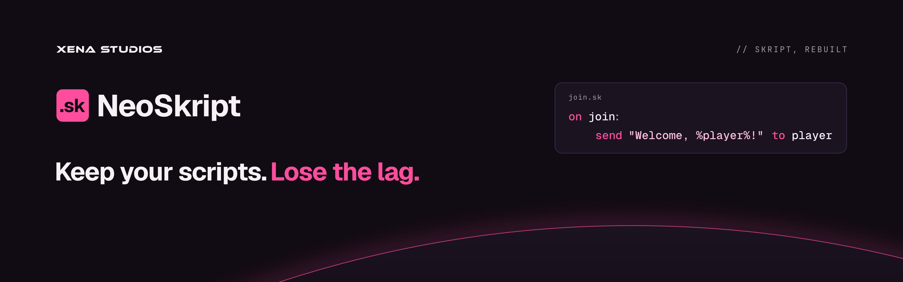

**Keep your scripts. Lose the lag.**

NeoSkript is a fast, modern drop-in replacement for [Skript](https://github.com/SkriptLang/Skript). Your `.sk` scripts run unchanged, only faster, on Paper and Folia.

**Status:** in development, nothing released yet. Skript's whole test suite passes on NeoSkript. See [progress](docs/PROGRESS.md).

## Building

Needs JDK 21, plus JDK 25 for the test harness's 26.x servers.

```sh
./gradlew build        # compile, unit tests, licence header check
./gradlew runServer    # Paper 1.21.4 dev server with NeoSkript
./gradlew runFolia     # Folia 1.21.4 dev server with NeoSkript
```

The plugin jar ends up in `neoskript-plugin/build/libs/`. The real-server tests are in the [test harness](test-harness/README.md).

## Checking your scripts

Before switching, see what NeoSkript makes of your scripts:

Download `neoskript-cli-<version>.jar` from the [releases](https://github.com/xena-studios/neoskript/releases?q=cli&expanded=true) (it needs Java 21, or 25 to check against Minecraft 26.3), then:

```sh
java -jar neoskript-cli-0.1.0.jar check plugins/Skript/scripts
```

To build it yourself: `./gradlew :neoskript-cli:shadowJar`, and the jar is in `neoskript-cli/build/libs/`.

It starts a throwaway headless Paper server (downloaded once into `~/.neoskript/cache` and checked against its SHA-256), loads the scripts there without running them, and lists each line NeoSkript won't load, Skript's warnings, and hints on what may behave differently on Folia or cost a lot of server time. Options: `--json <file>`, `--hints-only`, `--quiet`, `--minecraft 26.3|1.21.4`, `--verbose`. It exits with 0 when every script loads, 1 when some don't, and 2 when the check couldn't run.

## What's here

```
neoskript-api        the public addon API
neoskript-frontend   parser, type checker, diagnostics (no Bukkit)
neoskript-compiler   compiles scripts to JVM bytecode
neoskript-runtime    variables, storage, scheduling, waits
neoskript-paper      the standard library: Skript's syntax on Paper
neoskript-plugin     the plugin: /sk, config, reload
neoskript-cli        checks a scripts folder before you switch (M5)
test-harness         real Paper and Folia servers, run against Skript
website              neoskript.dev
plugins/skript       the AI skill for writing Skript (Claude Code, Codex)
```

| Doc | What's in it |
|---|---|
| [Plan](docs/PLAN.md) | Goals, locked decisions, architecture, roadmap |
| [Progress](docs/PROGRESS.md) | What each milestone and batch delivered |
| [Test harness](test-harness/README.md) | Running the real-server tests, scenarios, pins |

## Writing scripts with AI

The `skript` skill teaches coding agents to write Skript that loads on Skript and NeoSkript. In Claude Code:

```
/plugin install skript --marketplace xena-studios/neoskript
```

For Codex and other agents, see [Writing scripts with AI](https://neoskript.dev/docs/ai/).

## Contributing

Bugs and ideas go in [issues](https://github.com/xena-studios/neoskript/issues/new/choose). For pull requests, see the [contributing guide](https://github.com/xena-studios/.github/blob/main/CONTRIBUTING.md). Report security problems through the [security policy](https://github.com/xena-studios/.github/blob/main/SECURITY.md), never a public issue.

## Licence

[GPL-3.0-only](LICENSE).
